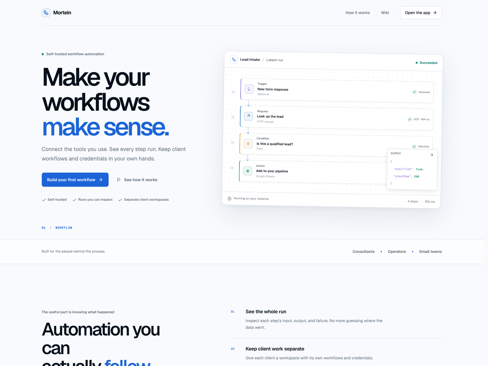
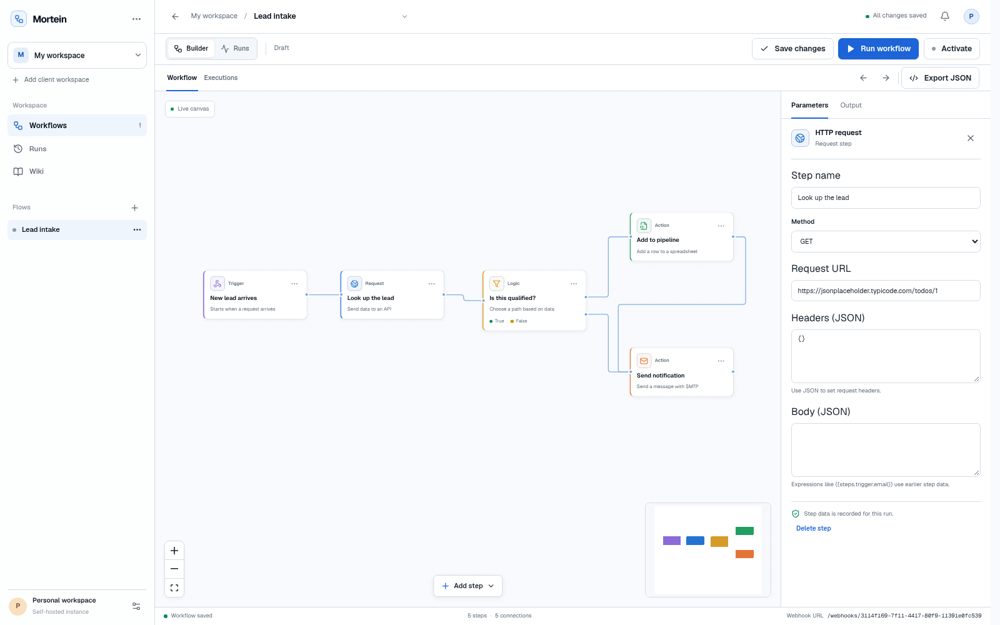

# Mortein

Mortein is a self-hosted workflow automation MVP for consultants and operators. Build a flow, run it with sample data, and inspect what each step received and returned. The product has its own visual identity and is inspired by node-based automation tools; it does not reuse n8n branding or assets.



The app opens to a sample lead-intake workflow you can edit and run:



## What works in this MVP

- **Landing page:** overview of the product, workflow preview, key benefits, and links into the app and help wiki.
- **Workflow editor:** create and switch workflows, create client workspaces, add and configure nodes, connect branches, save, activate, and run manually.
- **Workflow steps:** manual and webhook triggers, HTTP requests, conditions, Google Sheets row append, and SMTP email.
- **Run inspector:** queued/running/completed states, step-by-step input/output, errors, skipped branches, and duplicate-risk indication after external actions.
- **Credentials:** workspace-scoped SMTP credentials encrypted at rest; optional Google Sheets OAuth credentials.
- **Wiki:** searchable Markdown help at `/wiki` covering quick start, building a workflow, and troubleshooting runs.
- **Operations:** PostgreSQL-backed persistence and pg-boss execution queue; Bun workspaces; Biome lint and formatting.

The first-run example is a lead-intake workflow. Configure the HTTP, condition, Google Sheets, and SMTP steps for your service accounts before expecting its external actions to succeed. `bun test` includes an offline branch-routing/runtime test.

## Start locally

Requirements: Bun 1.2+, Docker Compose, and (for Google Sheets) a Google OAuth client.

```sh
cp .env.example .env
```

Generate a 32-byte encryption key and set `CREDENTIALS_ENCRYPTION_KEY` in `.env` to the resulting 64-character hex string:

```sh
openssl rand -hex 32
```

Start PostgreSQL and install dependencies:

```sh
docker compose -f deploy/compose.yaml up -d
bun install
bun run db:migrate
```

In separate terminals, start the API, worker, and web app:

```sh
bun run dev:api
bun run dev:worker
bun run dev:web
```

Open <http://localhost:5173>. The app and wiki are available without Google OAuth. To connect Google Sheets, set `GOOGLE_CLIENT_ID` and `GOOGLE_CLIENT_SECRET` in `.env`, and register `http://localhost:5173/api/google/callback` as an authorized redirect URI in Google Cloud. The API uses `PUBLIC_APP_URL` (default `http://localhost:5173`) to build OAuth redirects.

The development API listens on port `4310`; Vite proxies `/api` and `/webhooks` to it. The sample Compose file binds PostgreSQL to localhost. The app is an unauthenticated, single-user MVP: keep the web/API instance on a trusted local network until you put authentication and a secure public ingress in front of it. Webhook URLs are bearer URLs; treat them as secrets.

## Commands

| Command              | Purpose                                                   |
| -------------------- | --------------------------------------------------------- |
| `bun run dev:web`    | Start Vite web app on port 5173                           |
| `bun run dev:api`    | Start Fastify API on port 4310                            |
| `bun run dev:worker` | Start the pg-boss execution worker                        |
| `bun run db:migrate` | Create/update the PostgreSQL schema and initial workspace |
| `bun test`           | Run Bun tests                                             |
| `bun run typecheck`  | Typecheck each workspace                                  |
| `bun run lint`       | Run Biome checks                                          |
| `bun run format`     | Format repository files with Biome                        |
| `bun run build`      | Build each package that defines a build script            |

## Project map

```text
apps/
  api/                 Fastify API and webhook receiver
  web/                 React/Vite app, landing page, editor, and wiki UI
  worker/              pg-boss workflow execution worker
packages/
  database/            PostgreSQL schema, migrations, and repository
  integrations/        Credential encryption and node runtime
  wiki-content/        Searchable Markdown wiki pages
  workflow-domain/     Workflow types, schemas, and graph validation
deploy/                Local PostgreSQL Compose service
docs/                  Architecture and security notes
screenshots/           README product screenshots
```

See [DESIGN.md](DESIGN.md) for interface and design-system decisions, [PLAN.md](PLAN.md) for the staged roadmap, and [docs/ARCHITECTURE.md](docs/ARCHITECTURE.md) for service boundaries and execution flow.
